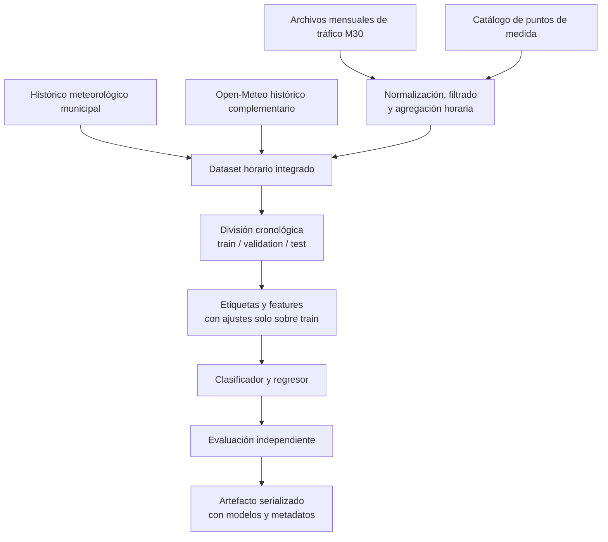
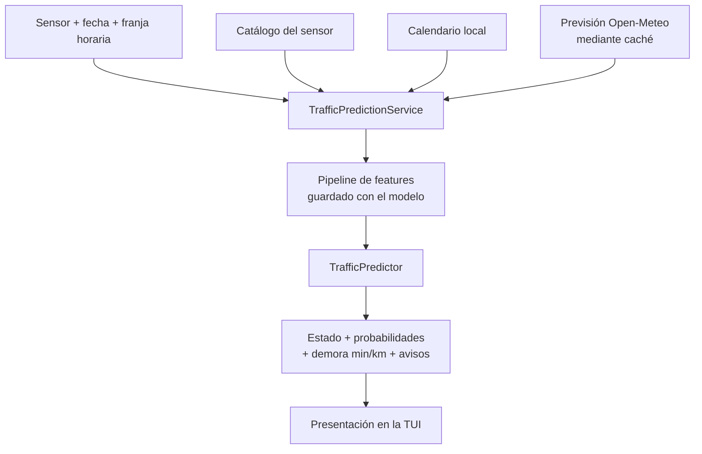

# Plan técnico — O.N.E. E.Y.E. M.O.N.S.T.E.R.

## 1. Resumen sencillo del producto

La aplicación permitirá elegir un **sensor conocido de la M30**, una fecha y una franja horaria futura. Para cada hora mostrará:

1. El estado previsto del tráfico: `Fluido`, `Moderado`, `Denso` o `Retención`.
2. La probabilidad asociada a cada estado.
3. La demora adicional estimada, expresada como **minutos por kilómetro (`min/km`)**.
4. Las condiciones meteorológicas utilizadas y avisos de calidad, cuando existan.

No se simularán vehículos, no se controlarán semáforos y no se recomendarán rutas en el MVP.

La aplicación funcionará localmente desde una TUI. No utilizará servidores web ni bases de datos externas.

## 2. Decisiones ya acordadas

| Tema | Decisión |
|---|---|
| Tráfico | Histórico oficial del Ayuntamiento de Madrid. |
| Cobertura | Sensores `M30` presentes en el histórico de entrenamiento. |
| Calidad | Descartar registros con `error != 'N'`; valores negativos significan ausencia de datos. |
| Resolución de entrada | Medidas de tráfico cada 15 minutos. |
| Resolución del modelo | Una predicción por sensor y hora. |
| Clasificación | Etiquetas derivadas de `carga` con umbrales fijos. |
| Regresión | Demora calculada a partir de `vmed` frente a una velocidad de flujo libre. |
| Unidad de demora | Tramo de referencia común de 1 km; salida en `min/km`. |
| Clima histórico | Observaciones municipales de Madrid desde 2019 como fuente principal local. |
| Complemento histórico | Open-Meteo para visibilidad, código meteorológico y huecos cubiertos por la configuración del spec. |
| Clima futuro | Previsiones de Open-Meteo, siempre mediante caché local. |
| Datos tabulares | `pandas.DataFrame`; no crear un objeto Python por cada medición. |
| Datos procesados | Parquet particionado; CSV para muestras pequeñas. |
| Modelos | Clasificador y regresor independientes, con preprocesamiento coherente. |
| Interfaz | TUI desacoplada mediante un contrato de servicio común para mocks y predicciones reales. |

### Consecuencia temporal importante

El uso del histórico meteorológico municipal limita el periodo integrado a partir de **enero de 2019**, aunque el histórico de tráfico comience en 2013. El periodo concreto se seleccionará tras inventariar los archivos y comprobar su calidad; no se cargarán todos los años completos en memoria.

## 3. Arquitectura propuesta

### 3.1 Flujo de preparación y entrenamiento



### 3.2 Flujo de consulta futura



La TUI nunca llamará directamente al dataset, a Open-Meteo ni a los estimadores.

## 4. Estructuras de datos principales

### 4.1 Medidas de tráfico normalizadas

Estas columnas pertenecen a un `DataFrame`; no definen una instancia por cada medición.

| Campo interno | Tipo | Unidad | Nulo | Origen | Significado |
|---|---|---|---|---|---|
| `sensor_id` | `int32` | — | No | `id` / `idelem` | Identificador estable del punto de medida. |
| `observed_at` | `datetime64[ns, Europe/Madrid]` | fecha-hora | No | `fecha` | Fecha y hora oficial de Madrid, convertida a fecha-hora con zona. |
| `intensity_vph` | `float32` | vehículos/hora | Sí | `intensidad` | Intensidad informada para el periodo de 15 minutos. |
| `occupancy_pct` | `float32` | % | Sí | `ocupacion` | Ocupación porcentual. |
| `road_load` | `float32` | 0–100 | Sí | `carga` | Grado de uso de la vía. |
| `avg_speed_kmh` | `float32` | km/h | Sí | `vmed` | Velocidad media para sensores M30. |
| `quality_status` | `category` | — | No | `error` | Calidad; solo se acepta `N` en entrenamiento. |
| `integration_samples` | `Int16` | muestras | Sí | `periodo_integracion` | Muestras integradas, útil para control de calidad. |

`intensity_vph` ya es una tasa en vehículos/hora. Al agregar cuatro lecturas de 15 minutos se calcula una media, nunca una suma.

### 4.2 Catálogo de puntos de medida

| Campo | Tipo | Unidad | Nulo | Significado |
|---|---|---|---|---|
| `sensor_id` | `int32` | — | No | Identificador permanente e índice del catálogo. |
| `central_code` | `string` | — | Sí | Equivalente a `cod_cent`, cuando esté disponible. |
| `sensor_name` | `string` | — | No | Nombre legible del punto de medida. |
| `utm_x` | `float64` | m UTM | Sí | Coordenada X del catálogo. |
| `utm_y` | `float64` | m UTM | Sí | Coordenada Y del catálogo. |
| `latitude` | `float64` | grados | Sí | Latitud derivada, si se calcula para consultas geográficas. |
| `longitude` | `float64` | grados | Sí | Longitud derivada, si se calcula para consultas geográficas. |

No se presuponen carriles, longitudes oficiales ni velocidades límite que no proporcione la fuente.

### 4.3 Dataset horario de modelado

El dataset integrado se describe mejor como dos contratos tabulares que se unen por `sensor_id` y `hour_utc`.

**Tráfico y cobertura por hora:**

| Campo | Tipo | Unidad | Nulo | Significado |
|---|---|---|---|---|
| `sensor_id` | `int32` | — | No | Punto de medida M30. |
| `hour_utc` | `datetime64[ns, UTC]` | fecha-hora | No | Hora en UTC, clave temporal inequívoca. |
| `local_datetime` | `datetime64[ns, Europe/Madrid]` | fecha-hora | No | Hora local para calendario y presentación. |
| `intensity_vph` | `float32` | vehículos/hora | Sí | Media horaria de la intensidad. |
| `occupancy_pct` | `float32` | % | Sí | Media horaria de la ocupación. |
| `road_load` | `float32` | 0–100 | Sí | Media horaria de la carga; base de la etiqueta. |
| `avg_speed_kmh` | `float32` | km/h | Sí | Media horaria de la velocidad; base de la demora. |
| `valid_15min_observations` | `Int8` | observaciones | No | Cuartos de hora válidos considerados. |

**Meteorología y trazabilidad del cruce:**

| Campo | Tipo | Unidad | Nulo | Significado |
|---|---|---|---|---|
| `temperature_c` | `float32` | °C | Sí | Temperatura horaria. |
| `precipitation_mm` | `float32` | mm | Sí | Precipitación horaria. |
| `rain_mm` | `float32` | mm | Sí | Lluvia horaria, con semántica propia de Open-Meteo. |
| `visibility_m` | `float32` | m | Sí | Visibilidad horaria. |
| `wind_speed_kmh` | `float32` | km/h | Sí | Velocidad del viento normalizada. |
| `weather_code` | `Int16` | código WMO | Sí | Código meteorológico categórico. |
| `weather_source` | `category` | — | No | `madrid_municipal` u `open_meteo`. |
| `source_location_id` | `string` | — | Sí | Estación o ubicación de origen. |
| `weather_match_distance_minutes` | `Int16` | min | Sí | Separación temporal del cruce. |
| `station_distance_km` | `float32` | km | Sí | Distancia entre sensor y estación. |

Reglas esenciales:

- `hour_utc` garantiza un orden temporal inequívoco.
- `local_datetime` usa `Europe/Madrid` para calendario y presentación.
- Los cambios de hora tendrán tests específicos.
- Se conserva la cobertura de cuartos de hora válidos.
- El mínimo de observaciones válidas por hora será configurable y se fijará con evidencia del análisis de calidad.
- No se imputarán etiquetas ausentes.
- Se conserva el origen meteorológico y la distancia temporal/geográfica del cruce.
- Se espera una cobertura de cruce meteorológico de al menos el 95 % sobre los registros elegibles.

### 4.4 Objetos pequeños de consulta y resultado

Los DTOs sí serán `dataclasses` tipadas. El siguiente bloque contiene las importaciones compartidas por los ejemplos; las estructuras se muestran por separado.

```python
from __future__ import annotations

from dataclasses import dataclass
from datetime import datetime
from enum import IntEnum
```

```python
class TrafficState(IntEnum):
    FLUIDO = 0
    MODERADO = 1
    DENSO = 2
    RETENCION = 3
```

```python
@dataclass(frozen=True)
class WeatherSummary:
    temperature_c: float | None
    precipitation_mm: float | None
    rain_mm: float | None
    visibility_m: float | None
    wind_speed_kmh: float | None
    weather_code: int | None
    source: str
```

```python
@dataclass(frozen=True)
class ForecastRequest:
    sensor_id: int
    start_at: datetime
    end_at: datetime
```

```python
@dataclass(frozen=True)
class ForecastPoint:
    timestamp: datetime
    traffic_state: TrafficState
    state_probabilities: dict[TrafficState, float]
    delay_minutes_per_km: float
    weather_summary: WeatherSummary
    warnings: tuple[str, ...]
```

```python
@dataclass(frozen=True)
class ForecastResult:
    sensor_id: int
    sensor_name: str
    points: tuple[ForecastPoint, ...]
    generated_at: datetime
    model_version: str
```

Las fechas serán conscientes de zona horaria. El contrato será idéntico para respuestas reales y mocks; los specs concretarán validación de rangos, redondeo y serialización.

## 5. Etiquetas de aprendizaje

### 5.1 Estado del tráfico

`TrafficStateLabeler` aplicará las reglas aprobadas sobre `road_load` horario:

| Condición | Etiqueta | Código |
|---|---|---:|
| `road_load < 25` | Fluido | 0 |
| `25 <= road_load < 50` | Moderado | 1 |
| `50 <= road_load < 75` | Denso | 2 |
| `road_load >= 75` | Retención | 3 |

Los valores ausentes no se clasificarán. Los valores fuera del dominio válido se tratarán como problemas de calidad, no como clases.

### 5.2 Demora por kilómetro

`DelayLabeler` aprenderá una velocidad de flujo libre por sensor usando únicamente las velocidades válidas de entrenamiento. Para un sensor \(s\), se define primero el conjunto:

$$
\mathcal{V}^{\text{train}}_{s}
=
\left\{
v_{\text{med},i}
\;\middle|\;
i \in \text{train},\;
s_i = s,\;
v_{\text{med},i} > 0
\right\}
$$

La velocidad de referencia es su percentil 90:

$$
v^{\text{ff}}_{s}
=
Q_{0.90}\!\left(\mathcal{V}^{\text{train}}_{s}\right)
$$

Para un tramo de referencia \(L\), los tiempos de recorrido a velocidad observada y en flujo libre son:

$$
T_{\text{obs}} = \frac{60\,L}{v_{\text{med}}},
\qquad
T_{\text{ff},s} = \frac{60\,L}{v^{\text{ff}}_{s}}
$$

La demora sobre ese tramo queda definida como:

$$
d_s = \max\!\left(0,\; T_{\text{obs}} - T_{\text{ff},s}\right)
$$

| Símbolo | Significado | Unidad |
|---|---|---|
| \(s\) | Sensor M30 analizado | — |
| \(i\) | Observación horaria de entrenamiento | — |
| \(v_{\text{med},i}\) | Velocidad media observada | km/h |
| \(v^{\text{ff}}_{s}\) | Percentil 90 de velocidad del sensor en train | km/h |
| \(L\) | Longitud del tramo de referencia | km |
| \(T_{\text{obs}}\), \(T_{\text{ff},s}\) | Tiempos de recorrido observado y de referencia | min |
| \(d_s\) | Demora sobre el tramo de referencia | min |

El factor \(60\) convierte horas en minutos. En el MVP se fija \(L = 1\,\mathrm{km}\), por lo que \(d_s\) se expresa directamente como `min/km`.

La etiqueta representa una **estimación derivada de velocidades puntuales**, no un tiempo de retraso medido sobre una ruta real completa.

El estimador P90 se ajustará una sola vez con train y se aplicará sin reajuste a train, validation y test. Sensores sin referencia válida quedarán excluidos del entrenamiento de regresión hasta resolver su calidad.

## 6. Features del primer MVP

Entradas permitidas:

- `sensor_id`, limitado a sensores conocidos.
- Hora y día de la semana cíclicos.
- Información de fin de semana y festivos dinámicos/locales de Madrid.
- Variables meteorológicas normalizadas.
- Localización, únicamente si su inclusión se valida experimentalmente.

No se utilizarán como predictores del mismo instante:

- `intensity_vph`.
- `occupancy_pct`.
- `road_load`.
- `avg_speed_kmh`.

Estas medidas describen lo ocurrido en el instante objetivo y no estarán disponibles en una consulta futura. Tampoco se incluirán lags en el primer MVP, para no exigir mediciones recientes.

La división temporal será anterior al ajuste de imputadores, escaladores, codificadores, velocidades P90 y estrategias de balanceo.

## 7. Estructura de clases y módulos

No se propone añadir paquetes nuevos en la raíz del proyecto.

| Ruta dentro de `src/one_eye_monster/` | Componentes | Responsabilidad |
|---|---|---|
| `data/madrid_traffic.py` | `MadridTrafficLoader`, `MadridSchemaNormalizer` | Leer archivos mensuales/chunks y normalizar variantes históricas de columnas y formatos. |
| `data/sensor_catalog.py` | `MadridSensorCatalogLoader` | Cargar identificadores, nombres y ubicaciones M30. |
| `data/aggregation.py` | `HourlyTrafficAggregator` | Agregar datos válidos de 15 minutos a horas y conservar cobertura. |
| `data/madrid_weather.py` | `MadridWeatherLoader`, `MadridWeatherStationCatalog`, `NearestWeatherStationResolver` | Normalizar observaciones municipales y relacionar estaciones con sensores. |
| `data/weather_cache.py` | `WeatherCache`, `FileWeatherCache` | Guardar histórico y previsiones con reglas de caducidad diferentes. |
| `data/open_meteo.py` | `OpenMeteoClient` | Obtener histórico complementario y forecast con caché obligatoria. |
| `data/dataset_builder.py` | `MadridDatasetBuilder` | Orquestar integración, alineación horaria y métricas de cobertura. |
| `features/targets.py` | `TrafficStateLabeler`, `DelayLabeler` | Generar las dos etiquetas sin fuga temporal. |
| `features/temporal.py` | `CyclicalFeatures`, `MadridCalendarFeatures` | Variables cíclicas y calendario local. |
| `features/pipeline.py` | `TrafficFeaturePipeline` | Transformaciones sklearn coherentes entre entrenamiento e inferencia. |
| `models/training.py` | `CongestionTrainer`, `DelayTrainer` | Entrenamiento, balanceo, ajuste y evaluación separada. |
| `models/artifact.py` | `ModelArtifact`, `ModelMetadata`, `EvaluationReport` | Versionar pipeline, modelos, sensores, métricas y reglas. |
| `models/inference.py` | `TrafficPredictor` | Inferencia pura, sin TUI ni acceso directo a APIs. |
| `models/service.py` | `PredictionService`, `TrafficPredictionService`, `ForecastRequest`, `ForecastResult` | Orquestar consultas y ofrecer el contrato consumido por la TUI. |
| `tui/app.py` | `OneEyeMonsterApp` y vistas necesarias | Captura de consultas y presentación; sin lógica de negocio. |
| `tui/mocks.py` | `MockPredictionService` | Respuestas simuladas compatibles con el mismo contrato. |
| `main.py` | Composición de dependencias | Crear servicios reales y arrancar la aplicación. |

Las clases anteriores son responsabilidades lógicas; durante los specs se podrán agrupar componentes pequeños si una separación adicional no aporta valor. No se crearán abstracciones para soportar otras ciudades en el MVP.

### Metadatos obligatorios del artefacto

```yaml
model_version: string
supported_sensor_ids: list[int]
training_time_range: datetime_range
validation_time_range: datetime_range
test_time_range: datetime_range
timezone: Europe/Madrid
traffic_temporal_resolution: 1h
source_temporal_resolution: 15min
reference_length_km: 1.0
classification_thresholds:
  Fluido: "< 25"
  Moderado: "25-49"
  Denso: "50-74"
  Retencion: ">= 75"
feature_names: list[str]
dataset_fingerprint: string
weather_sources:
  - madrid_municipal
  - open_meteo
dependency_versions: map[str, str]
classification_metrics: map[str, float]
regression_metrics: map[str, float]
```

## 8. Fuentes meteorológicas y comportamiento ante fallos

### Entrenamiento

- Se prioriza una observación municipal válida para las variables que realmente mide.
- Cada sensor se asocia con una estación o ubicación según reglas geográficas verificables.
- Open-Meteo complementa variables no disponibles municipalmente y huecos según el spec.
- Precipitación municipal y `rain` de Open-Meteo no se consideran silenciosamente equivalentes.
- Los cambios de fuente quedan registrados y se analizará su posible sesgo.

### Consulta futura

- Se utiliza Open-Meteo Forecast para cada hora solicitada.
- La caché distingue previsiones recientes de observaciones históricas.
- Si la fecha está fuera del horizonte disponible o no hay clima fiable, el servicio devuelve un aviso claro; no usa una previsión caducada como si fuera actual ni inventa datos.
- Los datos meteorológicos necesarios para inferencia local ya cacheados permiten medir latencia sin depender de la red.

Cualquier transformación geográfica o dependencia adicional necesaria se detallará en el spec y requerirá autorización antes de instalarse.

## 9. Plan de ejecución por fases

Se conservan los identificadores y entregables de la planificación existente. Las fechas de `PlanificaciónCronograma.md` (sección 3 y Gantt) sirven como **línea base**, no como afirmación de que una tarea ya esté completada.

### Fase 1 — Arquitectura y configuración inicial

Tareas heredadas: 1.1, 1.2, 1.3.

- Aprobar este plan y los contratos principales.
- Crear la estructura Python y configuración reproducible cuando empiece la implementación.
- Inventariar y congelar los archivos elegidos de tráfico, ubicaciones y clima municipal.
- Registrar periodo, checksum, procedencia y licencia de cada fuente.
- Extraer muestras pequeñas para validar formatos sin procesar todo el histórico.

**Hito H1:** arquitectura, specs iniciales, entorno y copias crudas inmutables validados.

### Fase 2 — Ingesta e integración de datos

Tareas heredadas: 2.1, 2.2, 2.3.

- Implementar lectura robusta de las variantes de Madrid.
- Filtrar M30 y calidad antes de acumular datos en memoria.
- Normalizar el catálogo de sensores y el clima municipal.
- Implementar caché y clientes de Open-Meteo.
- Agregar tráfico a horas y alinear meteorología con tolerancia explícita.
- Generar un informe de nulos, duplicados, cobertura y distancia de cruce.

**Hito H2:** dataset horario integrado y congelado, con al menos el 95 % de cobertura meteorológica sobre registros elegibles o una excepción documentada y aprobada.

### Fase 3 — Preprocesamiento y feature engineering

Tareas heredadas: 3.1, 3.2, 3.3.

- Definir reglas de horas válidas y tratamiento de valores anómalos.
- Implementar etiquetas de estado y demora de 1 km.
- Separar cronológicamente train, validation y test antes de cualquier ajuste.
- Implementar calendario, transformaciones cíclicas y pipeline sklearn.
- Ajustar transformaciones solo con train.
- Añadir tests de etiquetas, unidades, DST, cobertura y ausencia de fuga.

**Hito H3:** pipeline reproducible, datasets derivados y tests unitarios superados.

### Fase 4 — Modelado predictivo

Tareas heredadas: 4.1, 4.2, 4.3.

- Crear baselines sencillos para contextualizar las métricas.
- Entrenar el clasificador con balanceo explícito sobre train.
- Entrenar el regresor independiente de demora.
- Ajustar hiperparámetros usando únicamente train/validation.
- Evaluar test una sola vez al cerrar la selección.
- Registrar métricas por clase, matriz de confusión, Macro F1 y MAE en `min/km`.
- Serializar pipeline, modelos y metadatos.

Objetivos heredados:

- Macro F1 > 0,75.
- MAE < 5 en la unidad de demora aprobada.

**Hito H4:** ambos modelos evaluados y artefactos listos. No se ocultará el incumplimiento de una métrica: cualquier excepción requerirá revisión explícita.

### Fase 5 — TUI, limitada por la regla core-first

Tareas heredadas: 5.1 y 5.2, con un ajuste de orden.

- **5.1:** contratos, navegación básica y mocks pueden desarrollarse en paralelo a datos/IA.
- **5.2:** paneles completos, alertas y acabado visual se desarrollan después de validar el núcleo H4.
- La TUI consume exclusivamente `PredictionService`.
- Las fechas irreales o sin clima disponible muestran errores útiles.

**Hito H5:** interfaz funcional con servicio real sin lógica analítica en la capa visual.

Este ajuste resuelve la discrepancia entre el paralelismo del cronograma y la prioridad core-first de `CONSTITUTION.md`.

### Fase 6 — Integración y rendimiento

Tareas heredadas: 6.1 y 6.2.

- Sustituir mocks por servicio real.
- Probar el flujo completo de consulta por horas.
- Medir memoria y latencia de inferencia en local.
- Separar latencia de inferencia con datos cacheados del tiempo de descarga de red.

Objetivos:

- RAM < 4 GB.
- Inferencia local < 1 s en el escenario definido por el spec de rendimiento.

**Hito H6:** MVP integrado y auditoría de rendimiento superada o excepción aprobada.

### Fase 7 — Cierre y presentación

Tareas heredadas: 7.1, 7.2 y 7.3.

- Comprobar instalación limpia.
- Completar guía rápida y documentación técnica.
- Redactar informe final con fuentes, supuestos, métricas y limitaciones.
- Preparar presentación y demostración reproducible.

**Hito H7:** versión final validada y documentación congelada.

## 10. Catálogo de especificaciones técnicas

Este apartado actúa como **índice maestro**: conserva la relación de specs, su alcance y la visión global de pruebas, riesgos y aceptación del MVP. Cada spec ampliará las reglas y criterios de aceptación de su área, sin sustituir ni eliminar estos apartados.

| Spec | Contenido y criterios de aceptación |
|---|---|
| `001-arquitectura-y-contratos.md` | Diagrama final, clases, dependencias permitidas, DataFrames, DTOs y política de errores. |
| `002-datos-madrid-y-meteorologia.md` | Inventario de archivos, normalización, agregación horaria, caché, fuentes, geolocalización, alineación y cobertura. |
| `003-etiquetas-y-features.md` | Reglas de calidad, `carga`, demora `min/km`, calendario, partición temporal y prevención de fuga. |
| `004-modelado-e-inferencia.md` | Baselines, balanceo, entrenamiento doble, métricas, artefacto, carga e inferencia. |
| `005-servicio-tui-e-integracion.md` | Contrato real/mock, interacción, errores, pruebas E2E, rendimiento y empaquetado. |

Cuando los documentos se redacten, cada nombre de archivo de esta tabla pasará a ser un enlace a su spec correspondiente dentro de `docs/`. Los documentos detallados no duplicarán la visión global; se limitarán a desarrollar su parte del diseño.

Todos los specs incluirán:

1. Objetivo y alcance.
2. Fuera de alcance.
3. Entradas y salidas.
4. Reglas normales y casos de error.
5. Dependencias.
6. Ejemplos pequeños.
7. Tests obligatorios.
8. Criterios de aceptación verificables.

Al formalizar los specs también habrá que actualizar `docs/AGENTS.md` para reflejar la fuente meteorológica híbrida y la unidad final `delay_minutes_per_km`, manteniendo la documentación coherente con este plan.

## 11. Estrategia mínima de pruebas

Esta estrategia transversal permanecerá en el plan. Los specs concretarán los casos de prueba de cada módulo, pero no sustituirán esta visión global.

- **Unitarias:** normalización, filtros, unidades, agregación, etiquetas, fórmulas, calendario y caché.
- **Contrato:** servicio real/mock, esquema de DataFrames y contenido del artefacto.
- **Integración:** mes pequeño de tráfico + clima -> dataset -> predicción.
- **Antifuga:** ningún ajuste usa validation/test; ninguna entrada usa valores contemporáneos no disponibles.
- **Temporales:** orden cronológico, horas duplicadas/inexistentes y fronteras de ventanas.
- **Calidad:** nulos, negativos, `error`, duplicados, estaciones ausentes y cobertura.
- **Rendimiento:** RAM y latencia medidas en un escenario reproducible.

Cada fase termina con un checkpoint: resumen de archivos, pruebas ejecutadas, resultados y espera de aprobación antes de continuar.

## 12. Riesgos y límites que deben quedar documentados

Este inventario global de riesgos y limitaciones permanecerá en el plan. Los specs desarrollarán los controles y mitigaciones correspondientes sin eliminar el resumen.

- Las observaciones municipales comienzan en 2019.
- Entrenar con observaciones y consultar previsiones puede producir sesgo de fuente.
- `visibility`, `weather_code` y `rain` no deben inventarse a partir de magnitudes municipales no equivalentes.
- La demora es una estimación por kilómetro derivada de `vmed`, no el retraso medido de un trayecto completo.
- El histórico completo es grande: lectura particionada y filtrado temprano son requisitos, no optimizaciones opcionales.
- Una predicción solo se ofrecerá para sensores M30 conocidos y fechas con información meteorológica disponible.
- Los umbrales de macro F1 y MAE son objetivos de aceptación; no se afirmará que se cumplen hasta medirlos en test.

## 13. Definición de MVP terminado

Esta definición global de aceptación permanecerá en el plan. Los criterios particulares de cada spec deberán ser coherentes con ella.

El MVP estará terminado cuando un usuario pueda:

1. Instalar la aplicación desde una copia limpia.
2. Seleccionar un nombre/identificador M30 soportado.
3. Introducir una franja futura válida.
4. Obtener una salida horaria con estado, probabilidades, demora en `min/km`, clima y versión del modelo.
5. Comprender cualquier aviso o imposibilidad de predecir.
6. Ejecutar el flujo dentro de los límites de memoria y latencia acordados.

Y además exista evidencia reproducible de:

- Datos crudos inmutables y derivados versionados.
- Cobertura y calidad del cruce.
- Ausencia de fuga de información.
- Evaluación independiente de clasificación y regresión.
- Tests, linting y documentación actualizada.
