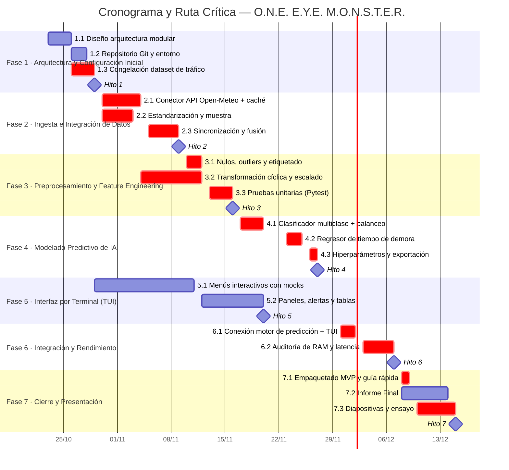

# Planificación de Proyecto: Estructura de Desglose de Trabajo y Cronograma

## O.N.E. E.Y.E. M.O.N.S.T.E.R.

*Observational Network Engine for Estimating Yield & Evaluating Mobility Over Nationwide Spatial Traffic & Environmental Resources*

- **Equipo:** Adriel Reyes (IA), Bruno Morales (Datos), F. Gabriel Ruiz (Software/TUI)
- **Herramientas de Gestión:** ProjectLibre (Gantt/Ruta Crítica) y GitHub Projects (Kanban)
- **Inicio:** 23/10/2026 | **Fin:** 15/12/2026 (38 días lab.)

> Conversión a Markdown de `PlanificaciónCronogramaSIGrupo7-O.N.E.-E.Y.E.-M.O.N.S.T.E.R..pdf`.

---

## 1. Evaluación y Selección de Herramientas de Gestión del Cronograma

Para garantizar el control formal de plazos, dependencias y cargas de trabajo, se ha evaluado el ecosistema de herramientas disponible en los laboratorios docentes junto con la infraestructura de control de versiones definida en el Acta de Constitución. Se ha optado por un esquema complementario basado en ProjectLibre para la planificación temporal gráfica y GitHub Projects para el seguimiento operativo diario [10].

ProjectLibre constituye el eje central de la planificación formal presentada en este documento. Permite estructurar la Estructura de Desglose del Trabajo (EDT/WBS) en tres niveles jerárquicos (Proyecto, 7 Fases resumen y 19 Tareas operativas junto a 7 Hitos de control), calcular automáticamente la ruta crítica del proyecto y asignar tanto recursos humanos como materiales en un calendario laboral estándar de 8 horas diarias (08:00 a 12:00 y 13:00 a 17:00, de lunes a viernes). Gracias a su motor de programación, se ha optimizado la duración total del proyecto desde el 23 de octubre de 2026 hasta el 15 de diciembre de 2026, logrando paralelizar el desarrollo de la interfaz por terminal (Fase 5) con las fases de ingeniería de datos y aprendizaje automático.

De forma sincronizada, GitHub Projects traslada cada tarea numerada de ProjectLibre a incidencias técnicas (Issues) vinculadas a las ramas de código del repositorio [10], operando bajo un tablero Kanban (Backlog, En progreso, Revisión, Hecho) que asegura revisiones cruzadas mediante pull requests antes de consolidar cada hito.

---

## 2. Asignación de Recursos Humanos y Medios Técnicos

La asignación de recursos se divide en personal técnico (con responsabilidades diferenciadas de liderazgo y apoyo) y medios materiales/tecnológicos preasignados, codificados exactamente según la tabla de recursos del archivo de proyecto (UID 1 a UID 7):

| ID / Inicial | Recurso Asignado | Grupo / Categoría | Rol y Responsabilidad en la Ejecución |
| --- | --- | --- | --- |
| **ARS** (ID 1) | Adriel Reyes | Personal - IA | Científico de Datos / Ingeniero de IA. Lidera la transformación cíclica, modelado multiclase/regresión, auditoría de latencia (< 1 s) y memoria (< 4 GB). |
| **BMH** (ID 2) | Bruno Morales | Personal - Datos | Ingeniero de Datos. Lidera la adquisición de aforos, conector de la API Open-Meteo, sincronización horaria, limpieza de nulos y pruebas unitarias. |
| **FGR** (ID 3) | F. Gabriel Ruiz | Personal - TUI | Desarrollador de Software. Lidera la arquitectura modular, configuración Git/entornos, desarrollo de interfaz en consola (TUI) y empaquetado MVP. |
| **PY-IA** (ID 4) | Python 3.10+ / Scikit-learn / XGBoost / Pandas | Software / Librerías | Entorno de ejecución local (venv/conda) [3] y librerías científicas para manipulación matricial y entrenamiento de modelos [12], [13], [14], [15]. |
| **TUI-OC** (ID 5) | Librerías TUI (Rich / Textual) & OpenCode | Software / Asistentes | Motores de renderizado interactivo en terminal [4], [6], [7] y asistente de generación de estructuras y código de soporte [2]. |
| **API-DATA** (ID 6) | API Open-Meteo & Portales Open Data / Kaggle | Datos / APIs | Servicio REST meteorológico sin cuota de autenticación [1] y repositorios públicos de registros históricos de volumen vehicular. |
| **GIT-HW** (ID 7) | Git / GitHub & Hardware Local | Infraestructura | Repositorio de control de versiones [10] y ordenadores convencionales de laboratorio sujetos a la restricción estricta de consumo inferior a 4 GB de RAM. |

---

## 3. Desglose de Fases y Definición Detallada de Tareas (EDT / WBS)

A continuación se detallan las siete fases que componen el proyecto. Cada fase incluye su introducción funcional, el enunciado íntegro del hito de control asociado y la explicación técnica accesible de cada tarea numerada, junto con su asignación de personal, medios, duración y fechas de inicio y fin extraídas de ProjectLibre.

### Fase 1: Arquitectura y Configuración Inicial (23/10/2026 - 29/10/2026 | 5 días / 40 h)

**Hito asociado (Hito 1 - 29/10/2026):** Definición de la arquitectura, selección del dataset de aforos vehiculares y configuración del repositorio base.

En esta etapa inicial se sientan los cimientos del proyecto antes de programar la lógica analítica. El objetivo es que los tres integrantes trabajen sobre un entorno estandarizado, dejando formalmente definido cómo se comunicarán las piezas del programa y asegurando una copia local inalterable de los datos históricos de tráfico sobre los que se apoyará todo el sistema.

- **1.1. Diseño de la arquitectura modular y diagrama de bloques** (23/10/2026 - 26/10/2026 | 2 días / 16 h | Normal): Definir la estructura del software dividiéndolo en 4 módulos independientes (ingesta de datos, limpieza, inteligencia artificial y pantalla de terminal) [4]. Se elabora un diagrama de bloques que especifica qué datos entran y salen de cada módulo para evitar incompatibilidades al integrar el código.
  - Responsable: F. Gabriel Ruiz | Apoyo: Adriel Reyes, Bruno Morales | Medios: Git / GitHub & Hardware Local (GIT-HW).
- **1.2. Configuración del repositorio Git, entorno virtual y estructura** (26/10/2026 - 28/10/2026 | 3 días / 24 h | Normal): Crear el espacio compartido en GitHub con su política de ramas [10], configurar el entorno aislado de Python 3.10+ (venv/conda) [3] para garantizar idénticas versiones de librerías en todos los equipos y generar la estructura de directorios base con apoyo de OpenCode [2].
  - Responsable: F. Gabriel Ruiz | Medios: TUI-OC, GIT-HW.
- **1.3. Selección, descarga y congelación del dataset histórico de tráfico** (26/10/2026 - 29/10/2026 | 4 días / 32 h | Crítica): Buscar y descargar en portales de datos abiertos un conjunto de registros reales con el volumen horario de vehículos. Se almacena una copia fija ("congelada") en local para mitigar el riesgo de que la fuente pública modifique su formato o deje de estar disponible durante el curso.
  - Responsable: Bruno Morales | Medios: PY-IA, API-DATA.

### Fase 2: Ingesta e Integración de Datos (30/10/2026 - 09/11/2026 | 7 días / 56 h)

**Hito asociado (Hito 2 - 09/11/2026):** Implementación del script de consumo de la API de Open-Meteo y cruce de datos con los registros de tráfico.

Las retenciones urbanas no dependen únicamente de la hora punta, sino también de factores meteorológicos adversos como lluvia intensa o baja visibilidad. En esta fase se construye de forma paralela el conector automático para extraer el clima desde internet y la estandarización de los registros viales, fusionando ambas fuentes en una tabla unificada.

- **2.1. Desarrollo del conector para la API de Open-Meteo con caché local** (30/10/2026 - 04/11/2026 | 4 días / 32 h | Crítica - Predecesora: 1.3): Programar un módulo en Python que consulte automáticamente al servicio gratuito Open-Meteo la temperatura, precipitación y visibilidad horaria [1]. Incorpora un sistema de memoria caché local que guarda las respuestas ya descargadas para no repetir peticiones y evitar bloqueos del servidor (rate limits).
  - Responsable: Bruno Morales | Medios: PY-IA, TUI-OC, API-DATA.
- **2.2. Estandarización del dataset de tráfico y muestra preliminar** (30/10/2026 - 03/11/2026 | 3 días / 24 h | Crítica - Predecesora: 1.3): Unificar el formato de las columnas de tráfico (nombres de variables, unidades métricas y marcas de tiempo) ejecutándose en paralelo al desarrollo del conector climático. Se extrae una muestra preliminar limpia que se entrega el 3 de noviembre a Adriel Reyes para adelantar la programación del pipeline matemático sin esperas.
  - Responsable: Bruno Morales | Medios: PY-IA.
- **2.3. Sincronización temporal y fusión de datasets: Tráfico + Clima** (05/11/2026 - 09/11/2026 | 3 días / 24 h | Crítica - Predecesoras: 2.1, 2.2): Unir las tablas de tráfico y meteorología utilizando la fecha y hora como clave de cruce. Dado que los sensores viales y las estaciones climáticas pueden registrar datos con minutos de desfase, se implementa una función de alineación por ventana horaria más cercana (nearest/linear), garantizando el cruce exitoso de al menos el 95% de los registros.
  - Responsable: Bruno Morales | Medios: PY-IA.

### Fase 3: Preprocesamiento y Feature Engineering (04/11/2026 - 16/11/2026 | 9 días / 72 h)

**Hito asociado (Hito 3 - 16/11/2026):** Pipeline de limpieza, tratamiento de nulos y generación de características cíclicas y normalizadas.

Los algoritmos predictivos requieren datos libres de ruido y representaciones matemáticas adecuadas: un modelo numérico estándar no comprende por sí solo que las 23:00 y las 00:00 son horas consecutivas. Esta fase depura lecturas anómalas y transforma las variables temporales en proyecciones circulares óptimas para el aprendizaje automático.

- **3.1. Tratamiento de valores nulos, atípicos (outliers) y etiquetado** (10/11/2026 - 12/11/2026 | 3 días / 24 h | Crítica - Predecesora: 2.3): Detectar y corregir caídas de sensores (valores vacíos) o lecturas imposibles por fallos técnicos sobre el dataset fusionado. Asimismo, se generan las dos variables objetivo que el sistema deberá predecir: la categoría del estado de la vía (Fluido, Moderado, Denso, Retención) y los minutos exactos de demora.
  - Responsable: Bruno Morales | Apoyo: Adriel Reyes | Medios: PY-IA.
- **3.2. Transformación cíclica de variables temporales y normalización** (04/11/2026 - 12/11/2026 | 7 días / 56 h | Crítica - Predecesora: 2.2): Iniciada tempranamente gracias a la muestra preliminar de la tarea 2.2, convierte la hora del día y el día de la semana en coordenadas trigonométricas (seno y coseno) para preservar su continuidad cíclica [5], y escala las variables continuas (lluvia, temperatura, flujo vehicular) a un rango uniforme.
  - Responsable: Adriel Reyes | Medios: PY-IA.
- **3.3. Pruebas unitarias automatizadas de la tubería de datos** (13/11/2026 - 16/11/2026 | 2 días / 16 h | Crítica - Predecesoras: 3.1, 3.2): Programar tests unitarios automatizados (mediante Pytest) que verifiquen que la tubería de preprocesamiento no introduce valores nulos residuales ni provoca fugas de información entre el conjunto de entrenamiento y el de prueba (data leakage).
  - Responsable: Bruno Morales | Apoyo: F. Gabriel Ruiz | Medios: PY-IA.

### Fase 4: Modelado Predictivo de Inteligencia Artificial (17/11/2026 - 27/11/2026 | 9 días / 72 h)

**Hito asociado (Hito 4 - 27/11/2026):** Entrenamiento de los modelos base de clasificación multiclase y regresión; ajuste de hiperparámetros.

Constituye el núcleo analítico de O.N.E. E.Y.E. M.O.N.S.T.E.R. Con el conjunto de datos validado, se entrenan y ajustan dos modelos complementarios de aprendizaje automático (clasificación del estado de congestión y regresión del tiempo de retardo), optimizando sus parámetros internos para alcanzar los umbrales de precisión y velocidad exigidos.

- **4.1. Entrenamiento del Clasificador Multiclase y balanceo de clases** (17/11/2026 - 20/11/2026 | 4 días / 32 h | Crítica - Predecesora: 3.3): Entrenamiento del modelo encargado de categorizar la vía en cuatro estados (Fluido, Moderado, Denso, Retención). Dado que las situaciones de retención severa son menos frecuentes que el tráfico fluido, se aplica reponderación de pesos en XGBoost [15] o sobremuestreo sintético SMOTE [16] para evitar sesgos.
  - Responsable: Adriel Reyes | Medios: PY-IA, GIT-HW.
- **4.2. Entrenamiento del modelo Regresor de tiempo de demora** (23/11/2026 - 25/11/2026 | 3 días / 24 h | Crítica - Predecesora: 4.1): Diseño y entrenamiento del segundo motor predictivo, destinado a estimar de forma cuantitativa los minutos adicionales de retraso que experimentará el conductor bajo las condiciones de flujo y meteorología introducidas.
  - Responsable: Adriel Reyes | Medios: PY-IA.
- **4.3. Optimización de hiperparámetros, validación y exportación** (26/11/2026 - 27/11/2026 | 2 días / 16 h | Crítica - Predecesora: 4.2): Ajuste fino de los árboles de decisión para superar los criterios de éxito del proyecto: un Macro F1-score superior al 75% en clasificación [8] y un Error Absoluto Medio (MAE) inferior a 5 minutos en regresión. Se exportan los modelos serializados (.joblib) listos para producción.
  - Responsable: Adriel Reyes | Medios: PY-IA.

### Fase 5: Desarrollo de Interfaz por Terminal - TUI (29/10/2026 - 20/11/2026 | 17 días / 136 h)

**Hito asociado (Hito 5 - 20/11/2026):** Construcción de la interfaz interactiva por terminal (TUI) y formateo de la salida visual.

Siguiendo la filosofía del «ojo único del cíclope» [9], toda la interacción del usuario se concentra en una única pantalla de consola limpia, rápida y sin necesidad de navegador web [4]. Esta fase se ejecuta de forma paralela a las fases de datos e IA desde finales de octubre utilizando datos simulados, eliminando cuellos de botella en el calendario.

- **5.1. Maquetación de menús interactivos en consola con mocks** (29/10/2026 - 11/11/2026 | 10 días / 80 h | Normal - Predecesora: 1.2): Programación de la estructura de navegación por teclado, formularios de entrada de parámetros (vía, fecha, franja horaria) y contenedores visuales empleando respuestas simuladas (mocks) para validar la usabilidad sin depender de que concluya el entrenamiento de los modelos.
  - Responsable: F. Gabriel Ruiz | Medios: TUI-OC.
- **5.2. Diseño visual de paneles de resultados, alertas y tablas** (12/11/2026 - 20/11/2026 | 7 días / 56 h | Normal - Predecesora: 5.1): Formateo estético de la salida en terminal mediante las librerías Rich [6] y Textual [7], incorporando tablas estructuradas, indicadores meteorológicos e identificación cromática inmediata según el nivel de congestión estimado.
  - Responsable: F. Gabriel Ruiz | Medios: TUI-OC.

### Fase 6: Integración del Sistema y Pruebas de Rendimiento (30/11/2026 - 07/12/2026 | 6 días / 48 h)

**Hito asociado (Hito 6 - 07/12/2026):** Integración completa (conexión del motor de inferencia con la TUI) y pruebas de rendimiento en local.

Una vez cerrados tanto los modelos predictivos (Hito 4) como la interfaz visual en consola (Hito 5), se ensamblan todos los componentes del sistema y se somete el conjunto a pruebas exhaustivas en máquinas convencionales para certificar el cumplimiento de las restricciones de hardware y tiempo real.

- **6.1. Conexión del motor de predicción y flujo real con la TUI** (30/11/2026 - 02/12/2026 | 3 días / 24 h | Crítica - Predecesoras: 4.3, 5.2): Sustitución de los datos simulados de la consola por el conector climático real desarrollado por Bruno Morales y los modelos serializados entrenados por Adriel Reyes, cerrando el flujo de extremo a extremo desde la consulta del usuario hasta la predicción en pantalla.
  - Responsable: F. Gabriel Ruiz | Apoyo: Adriel Reyes, Bruno Morales | Medios: GIT-HW.
- **6.2. Auditoría de rendimiento local: RAM < 4 GB y Latencia < 1 s** (03/12/2026 - 07/12/2026 | 3 días / 24 h | Crítica - Predecesora: 6.1): Monitorización técnica del ciclo completo de inferencia en un ordenador local estándar, optimizando la carga en memoria de los modelos y diccionarios para certificar tiempos de respuesta inferiores a 1 segundo y un consumo de memoria RAM estricto por debajo de los 4 GB.
  - Responsable: Adriel Reyes | Apoyo: F. Gabriel Ruiz | Medios: GIT-HW.

### Fase 7: Cierre, Documentación, Informe Final y Presentación (08/12/2026 - 15/12/2026 | 6 días / 48 h)

**Hito asociado (Hito 7 - 15/12/2026):** Validación final, documentación técnica del proyecto y congelación de la versión definitiva del software.

Etapa conclusiva dedicada a congelar la versión final del Producto Mínimo Viable (MVP) para su despliegue reproducible, redactar el Informe Final académico con el rigor técnico exigido en la asignatura y preparar el soporte visual y la demostración en directo para la defensa oral del proyecto.

- **7.1. Empaquetado del MVP, congelación de versión y guía rápida** (08/12/2026 - 09/12/2026 | 2 días / 16 h | Crítica - Predecesora: 6.2): Congelación de la rama principal en GitHub (release final), verificación de instalación limpia desde cero mediante el archivo de dependencias y redacción del manual de instalación y guía rápida de ejecución (README.md).
  - Responsable: F. Gabriel Ruiz | Medios: GIT-HW.
- **7.2. Redacción y maquetación del Informe Final del proyecto** (08/12/2026 - 14/12/2026 | 5 días / 40 h | Normal - Predecesora: 6.2): Elaboración conjunta de la memoria técnica final del proyecto, documentando la arquitectura modular (F. Gabriel Ruiz), la ingeniería y cobertura de datos (Bruno Morales) y la evaluación experimental de los modelos predictivos junto con el análisis de métricas (Adriel Reyes).
  - Responsables: Adriel Reyes, Bruno Morales, F. Gabriel Ruiz.
- **7.3. Diseño de diapositivas y ensayo de la Presentación Final** (10/12/2026 - 15/12/2026 | 4 días / 32 h | Crítica - Predecesora: 7.1): Creación del material visual de apoyo para la exposición oral, preparación del guion de defensa repartido equitativamente entre los tres miembros y ensayo cronometrado de la demostración en vivo de la interfaz TUI ejecutando predicciones en tiempo real.
  - Responsable: Bruno Morales (coordinación visual), Adriel Reyes, F. Gabriel Ruiz | Medios: GIT-HW.

---

## 4. Matriz Consolidada de Tareas, Recursos, Tiempos y Fechas

La siguiente tabla resume la totalidad de tareas numeradas, hitos, dependencias predecesoras, responsables, recursos asignados y fechas exactas de inicio y fin según el modelo procesado en ProjectLibre:

| # | Nombre | Duración | Inicio | Terminado | Predecesores |
| --- | --- | --- | --- | --- | --- |
| 1 | O.N.E. E.Y.E. M.O.N.S.T... | 46 days | 9/11/26 8:00 | 11/01/27 17:00 | |
| 2 | Fase 1: Definicion, A... | 6 days | 9/11/26 8:00 | 16/11/26 17:00 | |
| 3 | Configuracion de re... | 2 days | 9/11/26 8:00 | 10/11/26 17:00 | |
| 4 | Seleccion y adquisic... | 3 days | 9/11/26 8:00 | 11/11/26 17:00 | |
| 5 | Elaboracion del Doc... | 3 days | 12/11/26 8:00 | 16/11/26 17:00 | 4 |
| 6 | Hito 1: Definicion de... | 0 days | 16/11/26 17:00 | 16/11/26 17:00 | 3;5 |
| 7 | Fase 2: Ingesta y Cr... | 8 days | 17/11/26 8:00 | 26/11/26 17:00 | |
| 8 | Desarrollo del client... | 4 days | 17/11/26 8:00 | 20/11/26 17:00 | 6 |
| 9 | Sincronizacion Temp... | 4 days | 23/11/26 8:00 | 26/11/26 17:00 | 8 |
| 10 | Hito 2: Implementac... | 0 days | 26/11/26 17:00 | 26/11/26 17:00 | |
| 11 | Fase 3: Preprocesam... | 7 days | 27/11/26 8:00 | 7/12/26 17:00 | 9 |
| 12 | Limpieza de nulos, t... | 3 days | 27/11/26 8:00 | 1/12/26 17:00 | 10 |
| 13 | Transformacion det... | 4 days | 2/12/26 8:00 | 7/12/26 17:00 | 12 |
| 14 | Desarrollo de prueb... | 3 days | 2/12/26 8:00 | 4/12/26 17:00 | 12 |
| 15 | Hito 3: Pipeline de li... | 0 days | 7/12/26 17:00 | 7/12/26 17:00 | 13;14 |
| 16 | Fase 4: Desarrollo y ... | 10 days | 8/12/26 8:00 | 21/12/26 17:00 | |
| 17 | Entrenamiento y bal... | 5 days | 8/12/26 8:00 | 14/12/26 17:00 | 15 |
| 18 | Entrenamiento del ... | 3 days | 15/12/26 8:00 | 17/12/26 17:00 | 17 |
| 19 | Ajuste de hiperpara... | 2 days | 18/12/26 8:00 | 21/12/26 17:00 | 18 |
| 20 | Hito 4: Modelos pre... | 0 days | 21/12/26 17:00 | 21/12/26 17:00 | 19 |
| 21 | Fase 5: Construccion... | 10 days | 8/12/26 8:00 | 21/12/26 17:00 | |
| 22 | Diseno visual de co... | 5 days | 8/12/26 8:00 | 14/12/26 17:00 | 15 |
| 23 | Formateo visual inte... | 5 days | 15/12/26 8:00 | 21/12/26 17:00 | 22 |
| 24 | Hito 5: Modulo de In... | 0 days | 21/12/26 17:00 | 21/12/26 17:00 | 23 |
| 25 | Fase 6: Integracion I... | 8 days | 22/12/26 8:00 | 31/12/26 17:00 | |
| 26 | Acoplamiento del m... | 5 days | 22/12/26 8:00 | 28/12/26 17:00 | 20;24 |
| 27 | Validacion de latenc... | 3 days | 29/12/26 8:00 | 31/12/26 17:00 | 26 |
| 28 | Hito 6: Integracion c... | 0 days | 31/12/26 17:00 | 31/12/26 17:00 | 27 |
| 29 | Fase 7: Validacion Fi... | 7 days | 1/01/27 8:00 | 11/01/27 17:00 | |
| 30 | Pruebas de aceptaci... | 3 days | 1/01/27 8:00 | 5/01/27 17:00 | 28 |
| 31 | Manual de instalaci... | 4 days | 6/01/27 8:00 | 11/01/27 17:00 | 30 |
| 32 | Hito 7: Validacion fin... | 0 days | 11/01/27 17:00 | 11/01/27 17:00 | 31 |

> **Nota de conversión:** Esta tabla es la transcripción literal de la captura de ProjectLibre incrustada como imagen en el PDF original (los nombres de tarea aparecen truncados con `...` en la propia captura). Dicha captura corresponde a una versión anterior del plan (46 días, del 9/11/26 al 11/01/27) y sus fechas no coinciden con el desglose detallado de la sección 3 ni con los hitos del diagrama de Gantt de la sección 5, que sí reflejan el calendario definitivo (23/10/2026 - 15/12/2026). Se conserva aquí para no perder ninguna información del documento original.

---

## 5. Representación Gráfica del Cronograma y Ruta Crítica (Diagrama de Gantt)

El siguiente cronograma visual refleja la distribución semanal de las tareas desde la Semana 1 (23 de octubre) hasta la Semana 8 (15 de diciembre de 2026). Las barras en color rojo oscuro (#991B1B) identifican las tareas pertenecientes a la Ruta Crítica calculada en ProjectLibre (aquellas cuya demora retrasaría directamente la fecha de entrega final del 15 de diciembre), mientras que las barras en gris pizarra (#475569) representan tareas con holgura o ejecutadas en ramas paralelas:

> **Nota de conversión:** El PDF original incluía este cronograma como imagen. Se reconstruye aquí en Mermaid a partir de las fechas y la clasificación «Crítica / Normal» de la sección 3. Las tareas marcadas `crit` equivalen a las barras rojas (#991B1B) de la Ruta Crítica; el resto equivale a las barras gris pizarra (#475569) con holgura o en ramas paralelas.

---

## 6. Referencias

1. **[1]** Open-Meteo, «Open-Meteo Weather API Documentation», Open-Meteo.com, 2026. Disponible en: https://open-meteo.com
2. **[2]** OpenCode, «OpenCode: AI-Powered Coding Assistant», OpenCode.ai, 2026. Disponible en: https://opencode.ai
3. **[3]** Python Software Foundation, «Python Language Reference and Documentation», Python.org, 2026. Disponible en: https://www.python.org
4. **[4]** Deska, «Diferencias entre interfaces CLI, TUI y GUI para agentes», Deska Blog, 2026. Disponible en: https://deska.dev/es/blog/cli-vs-tui-vs-gui-agents
5. **[5]** Train in Data, «Cyclical Features: User Guide», Feature-engine Documentation, 2026. Disponible en: https://feature-engine.trainindata.com/en/latest/user_guide/creation/Cyclical_Features.html
6. **[6]** W. McGugan, «Rich Documentation», Read the Docs, 2026. Disponible en: https://rich.readthedocs.io/en/stable
7. **[7]** Textualize, «Textual Documentation: Rapid Application Development for Python», Textualize.io, 2026. Disponible en: https://textual.textualize.io
8. **[8]** Scikit-learn Developers, «sklearn.metrics.f1_score», Scikit-learn Documentation, 2026. Disponible en: https://scikit-learn.org/stable/modules/generated/sklearn.metrics.f1_score.html
9. **[9]** Wikipedia, «Cíclope», Wikipedia, La enciclopedia libre, 2026. Disponible en: https://es.wikipedia.org/wiki/C%C3%ADclope
10. **[10]** GitHub, Inc., «GitHub: Let's build from here», GitHub, 2026. Disponible en: https://github.com
11. **[12]** Pandas Development Team, «pandas: Powerful Python data analysis toolkit», Pandas.pydata.org, 2026. Disponible en: https://pandas.pydata.org/docs
12. **[13]** NumPy Developers, «NumPy Documentation», Numpy.org, 2026. Disponible en: https://numpy.org/doc
13. **[14]** Scikit-learn Developers, «scikit-learn: Machine Learning in Python», Scikit-learn Documentation, 2026. Disponible en: https://scikit-learn.org/stable
14. **[15]** XGBoost Developers, «XGBoost Documentation», Read the Docs, 2026. Disponible en: https://xgboost.readthedocs.io
15. **[16]** Wikipedia, «Synthetic minority oversampling technique», Wikipedia, The Free Encyclopedia, 2026. Disponible en: https://en.wikipedia.org/wiki/Synthetic_minority_oversampling_technique

> **Nota de conversión:** En el documento original la numeración de referencias salta de [10] a [12]; la referencia [11] no aparece. Se conserva la numeración original (los números de lista anteriores son solo ordinales de Markdown).
