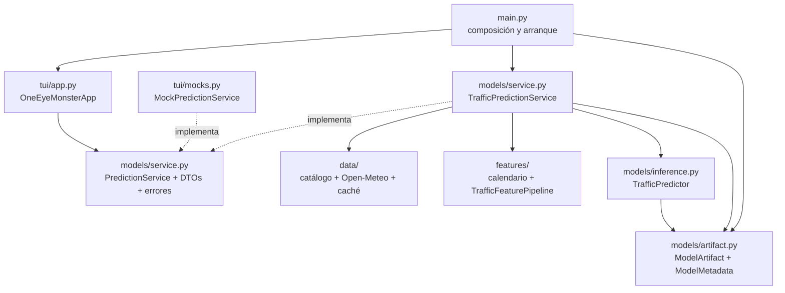

# Spec 001 — Arquitectura y contratos

**Estado:** Borrador para revisión  
**Referencias:** [PLAN.md](../PLAN.md), [CONSTITUTION.md](../CONSTITUTION.md), [AGENTS.md](../AGENTS.md)

## Guía rápida (en 1 minuto)

Este documento fija **cómo se conectan las piezas del proyecto** para que podamos desarrollar datos, modelos e interfaz sin que una capa rompa a otra:

- **La TUI (`tui/`) es solo una pantalla:** recoge lo que pide el usuario y muestra resultados o errores. No lee CSV/Parquet, no llama a Open-Meteo y no carga modelos.
- **Un único contrato de consulta (`PredictionService`):** tanto el servicio real como el de prueba (`MockPredictionService`) reciben un `ForecastRequest` y devuelven un `ForecastResult`.
- **Tablas para el histórico, objetos pequeños para la consulta:** los millones de filas históricas van en `pandas.DataFrame`; la consulta del usuario y su respuesta van en `dataclasses` inmutables.
- **Regla horaria única:** toda consulta usa un intervalo **`[start_at, end_at)`** (incluye la hora de inicio y excluye la de fin), siempre con zona horaria explícita y normalizado internamente a UTC.

---

## 1. Objetivo y alcance

Definir las fronteras entre módulos, los DTOs públicos de consulta, el protocolo `PredictionService`, la jerarquía mínima de errores y el mapa de contratos tabulares que el resto de specs desarrollan en detalle.

## 2. Fuera de alcance

- Formato interno de los archivos crudos de Madrid, cruce meteorológico y caché (ver [Spec 002](002-datos-madrid-y-meteorologia.md)).
- Fórmulas de etiquetas, velocidad P90, calendario y pipeline de features (ver [Spec 003](003-etiquetas-y-features.md)).
- Entrenamiento, balanceo, métricas y formato en disco del modelo (ver [Spec 004](004-modelado-e-inferencia.md)).
- Pantallas concretas de la TUI, pruebas E2E y medición de tiempos/memoria (ver [Spec 005](005-servicio-tui-e-integracion.md)).
- Servidores web, bases de datos externas, simulación de tráfico o recomendación de rutas.

## 3. Arquitectura y dependencias permitidas

### 3.1 Mapa de componentes



### 3.2 Quién puede importar a quién

| Capa / módulo | Puede usar | Tiene prohibido usar |
|---|---|---|
| `tui/app.py` | `PredictionService`, DTOs y excepciones de `models.service`; `rich`, `textual`. | `data/`, `features/`, `models.inference`, `models.training`, `pandas`, clientes HTTP o archivos de modelos. |
| `tui/mocks.py` | Contrato de `models.service` y datos fijos en memoria. | Red, caché en disco, datasets o modelos entrenados. |
| `models/service.py` | Catálogo, cliente/caché meteorológica, pipeline de features, `TrafficPredictor` y metadatos del artefacto. | `tui/` (`rich`, `textual`), lectura de históricos crudos o entrenamiento. |
| `models/inference.py` | Matriz de features ya preparada y objetos del `ModelArtifact`. | `tui/`, `data/`, red, caché, archivos o calendario. |
| `features/` | `pandas`, `numpy`, `scikit-learn` y calendario local. | `tui/`, llamadas de red o estimadores de `models/`. |
| `data/` | `pandas`, `numpy`, archivos locales y Open-Meteo mediante caché. | `tui/`, `models/` o modificación de archivos crudos. |
| `main.py` | Todos los módulos anteriores para cablear la aplicación al arrancar. | Lógica de negocio, cálculos de features o reglas de validación propias. |

### 3.3 Mapa de DataFrames entre fases

Los datos tabulares nunca se convierten en listas de objetos Python. Cada tabla se valida al salir de su módulo productor:

| Tabla (`DataFrame`) | Clave lógica | Productor → Consumidor | Definición detallada |
|---|---|---|---|
| Tráfico normalizado (15 min) | `sensor_id`, `observed_at` | `MadridTrafficLoader` → `HourlyTrafficAggregator` | [Spec 002](002-datos-madrid-y-meteorologia.md) |
| Catálogo de sensores M30 | `sensor_id` | `MadridSensorCatalogLoader` → `data/` y `TrafficPredictionService` | [Spec 002](002-datos-madrid-y-meteorologia.md) |
| Tráfico horario | `sensor_id`, `hour_utc` | `HourlyTrafficAggregator` → `MadridDatasetBuilder` | [Spec 002](002-datos-madrid-y-meteorologia.md) |
| Meteorología horaria | `source_location_id`, `observed_at_utc` | Loaders / `OpenMeteoClient` → `MadridDatasetBuilder` y servicio | [Spec 002](002-datos-madrid-y-meteorologia.md) |
| Dataset horario integrado | `sensor_id`, `hour_utc` | `MadridDatasetBuilder` → `features/` y `models/training.py` | [Spec 002](002-datos-madrid-y-meteorologia.md) y [Spec 003](003-etiquetas-y-features.md) |
| Matriz de features | Orden posicional por hora | `TrafficFeaturePipeline` → `CongestionTrainer`, `DelayTrainer`, `TrafficPredictor` | [Spec 003](003-etiquetas-y-features.md) y [Spec 004](004-modelado-e-inferencia.md) |

## 4. Entradas y salidas públicas (DTOs y servicio)

### 4.1 DTOs en Python 3.10+

Definidos en `src/one_eye_monster/models/service.py`:

```python
from __future__ import annotations

from dataclasses import dataclass
from datetime import datetime
from enum import IntEnum
from typing import Protocol


class TrafficState(IntEnum):
    FLUIDO = 0
    MODERADO = 1
    DENSO = 2
    RETENCION = 3


@dataclass(frozen=True)
class WeatherSummary:
    temperature_c: float | None
    precipitation_mm: float | None
    rain_mm: float | None
    visibility_m: float | None
    wind_speed_kmh: float | None
    weather_code: int | None
    source: str


@dataclass(frozen=True)
class ForecastRequest:
    sensor_id: int
    start_at: datetime
    end_at: datetime


@dataclass(frozen=True)
class ForecastPoint:
    timestamp: datetime
    traffic_state: TrafficState
    state_probabilities: dict[TrafficState, float]
    delay_minutes_per_km: float
    weather_summary: WeatherSummary
    warnings: tuple[str, ...]


@dataclass(frozen=True)
class ForecastResult:
    sensor_id: int
    sensor_name: str
    points: tuple[ForecastPoint, ...]
    generated_at: datetime
    model_version: str


class PredictionService(Protocol):
    def predict(self, request: ForecastRequest) -> ForecastResult:
        """Devuelve la predicción horaria para [start_at, end_at) o lanza PredictionError."""
        ...
```

### 4.2 Invariantes de los datos devueltos

- **`points`:** contiene exactamente una entrada por cada hora UTC dentro de `[start_at, end_at)`, ordenadas de menor a mayor y sin huecos.
- **`state_probabilities`:** diccionario nuevo por punto con las 4 claves de `TrafficState`, valores finitos en `[0.0, 1.0]` y suma `1.0` ($\pm 10^{-6}$).
- **`traffic_state`:** la clase con mayor probabilidad (si hay empate exacto, gana el código numérico menor).
- **`delay_minutes_per_km`:** `float` finito $\ge 0.0$, expresado en minutos por kilómetro sobre el tramo de referencia de 1 km.
- **`warnings`:** tupla de códigos en `snake_case` (sin duplicados) para avisos no bloqueantes, por ejemplo cuando un campo meteorológico concreto ha sido imputado.

## 5. Reglas de validación y errores

### 5.1 Reglas de tiempo e intervalo

1. **Intervalo semiabierto `[start_at, end_at)`:** una consulta de `09:00` a `11:00` devuelve dos puntos (`09:00` y `10:00`).
2. **Zona horaria obligatoria:** se rechazan `datetime` sin zona (*naive*).
3. **Sin horas ambiguas ni inexistentes:** si el usuario pasa una hora local de `Europe/Madrid` que no existe (salto de primavera) o que ocurre dos veces (cambio de otoño), se rechaza la petición antes de consultar red o modelos.
4. **Horas en punto y futuras:** tras convertir a UTC, minutos, segundos y microsegundos deben ser `0` (no se redondea en silencio). Además, `start_at < end_at` y `start_at` debe ser posterior al instante actual del reloj inyectado.

### 5.2 Excepciones de dominio

La TUI solo necesita conocer estas cinco excepciones públicas:

```python
class PredictionError(Exception):
    """Error base del servicio de predicción."""


class InvalidForecastRequestError(PredictionError):
    """Fechas sin zona, no alineadas a hora, pasadas, invertidas o con cambio DST inválido."""


class UnknownSensorError(PredictionError):
    """El sensor_id no existe en el catálogo o no está soportado por el modelo cargado."""


class WeatherUnavailableError(PredictionError):
    """Falta previsión meteorológica vigente para alguna de las horas solicitadas."""


class ModelUnavailableError(PredictionError):
    """El artefacto del modelo no se puede cargar o es incompatible."""
```

No se devuelven resultados a medias: si falta el pronóstico meteorológico de una hora indispensable del rango, se lanza `WeatherUnavailableError`.

## 6. Dependencias

Solo se utiliza el stack ya aprobado en `docs/AGENTS.md`:
- Biblioteca estándar de Python 3.10+ (`dataclasses`, `datetime`, `enum`, `typing`, `zoneinfo`, `pathlib`).
- `pandas`, `numpy`, `scikit-learn`, `xgboost`, `rich`, `textual`, `pytest` y `ruff`.
- Prohibido añadir `pydantic`, frameworks web o clientes HTTP externos sin autorización previa.

## 7. Ejemplo práctico

```python
from datetime import datetime, timezone
from zoneinfo import ZoneInfo

madrid_tz = ZoneInfo("Europe/Madrid")

request = ForecastRequest(
    sensor_id=1001,
    start_at=datetime(2026, 7, 15, 9, 0, tzinfo=madrid_tz),
    end_at=datetime(2026, 7, 15, 11, 0, tzinfo=madrid_tz),
)

result = service.predict(request)
# result.points tiene 2 elementos:
# - 2026-07-15 07:00Z (09:00 en Madrid)
# - 2026-07-15 08:00Z (10:00 en Madrid)
```

Si alguien solicita `datetime(2026, 3, 29, 2, 0, tzinfo=madrid_tz)` (hora inexistente por cambio de hora), `service.predict(request)` lanza directamente `InvalidForecastRequestError` sin tocar la caché ni la red.

## 8. Tests obligatorios

1. **Invariantes de DTOs:** `frozen=True` impide reasignar campos; `state_probabilities` exige las 4 clases de `TrafficState`, suma 1 y no se comparte por referencia entre puntos; `delay_minutes_per_km` nunca es negativo.
2. **Validación temporal y DST:** rechaza `datetime` *naive*, minutos distintos de cero, `start_at >= end_at`, fechas en el pasado, hora local inexistente de primavera y hora local ambigua de otoño (con `fold=0` y `fold=1`).
3. **Semántica `[start_at, end_at)`:** comprueba que el número de puntos devueltos es exactamente `(end_utc - start_utc) / 1h`, con `start_at` incluido y `end_at` excluido.
4. **Contrato común real / mock:** la misma batería de tests parametrizados pasa tanto contra `MockPredictionService` como contra `TrafficPredictionService` (usando dobles para clima y modelo).
5. **Orden de orquestación sin efectos laterales:** si el request o el sensor son inválidos, el servicio falla con `InvalidForecastRequestError` o `UnknownSensorError` habiendo hecho **cero** llamadas al cliente meteorológico y al predictor.
6. **Aislamiento de capas (imports):** test estático que verifica que `tui/` solo importa de `models.service` (nunca de `data/`, `features/` o `models.inference`) y que `models/inference.py` no importa clientes de red, caché ni TUI.

## 9. Criterios de aceptación

- [ ] **CA-001-1:** Los DTOs, `TrafficState`, `PredictionService` y las 5 excepciones existen en `models/service.py` con las firmas y tipos exactos de la sección 4.1.
- [ ] **CA-001-2:** Tanto `TrafficPredictionService` como `MockPredictionService` superan la misma batería de tests de contrato sin adaptadores intermedios.
- [ ] **CA-001-3:** Las pruebas de validación temporal y cambios de hora (primavera/otoño) pasan al 100 % sin llamadas a red.
- [ ] **CA-001-4:** Los tests de aislamiento de imports confirman que la TUI y el predictor cumplen la tabla de dependencias de la sección 3.2.
